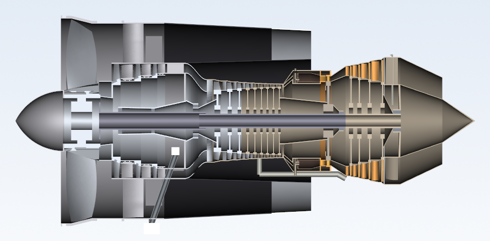

# CFM56-7B27 Turbofan Engine Concept Design with AI

**[English](#english) · [Türkçe](#türkçe)**



---

## English

A multi-agent AI system that designs a CFM56-7B27 class turbofan at concept level, from the thermodynamic cycle
to 3D geometry. One engine agent (M0) coordinates nine module agents (M1-M9). Every number is produced by code
and carries a provenance tag; every cross-module change needs the user's approval.

> Independent educational study. Not affiliated with or endorsed by CFM International, GE Aerospace or Safran.
> Values come from public sources, calculations and stated estimates. Not for real engineering use.

### At a glance

| | |
|---|---|
| Agents | M0 engine + 9 module agents |
| Parts | 119 part definitions, 3,105 instances (blades and vanes counted one by one) |
| Parameters | 221 tagged design input parameters |
| Tests | 753 automated tests |
| Records | 34 immutable design revisions, 16 decision records (ADRs) |
| Design point | Sea level, ISA, maximum take-off: 121.4 kN thrust, BPR 5.0, OPR 28.6 (computed `[H]`) |

### Modules

| Module | Owns | Status |
|---|---|---|
| M0 Engine | Cycle, station table, interface budgets (ICD), final assembly | accepted |
| M1 Inlet & Fan | Fan blades, disk, spinner, shims, case, containment ring, OGVs, fan frame | accepted |
| M2 Booster | 3-stage blades and vanes, inner shrouds, drum, case | concept |
| M3 HP Compressor | Inlet duct, IGV, 9 stages, spools, cases, CDP seal | concept |
| M4 Combustor | Diffuser, liners, dome, 20 fuel injectors, cases | concept |
| M5 HP Turbine | NGV, 80 rotor blades, disk, shafts, air seal, shroud | concept |
| M6 LP Turbine | 4 stages of vanes, blades and disks, shaft, conical support, case | concept |
| M7 Nozzle | Bypass duct, fan nozzle, turbine rear frame, core nozzle, plug | concept |
| M8 Shaft & Bearing | Fan and LP shafts, bearings No. 1-5, supports | concept |
| M9 Secondary Air & Oil | Gearboxes, drive shafts, oil tank and lines, bleed duct | concept |

"Accepted" means concept-level acceptance ([ADR-016](docs/decisions/ADR-016-concept-level-acceptance.md)).

### How it works

- **Three layers:** AI agents decide and call the code; files in git hold the whole design state; a Streamlit UI
  shows the design and takes the user's approvals.
- **Single source of truth:** each module's `engine/<module>/bom/bom.yaml`, written only through `core/bom.py`.
  Geometry is generated only by the module's `geometry/` code.
- **Provenance tags:** `[K]` primary source, `[KS]` secondary source, `[H]` computed, `[G]` general engineering
  knowledge, `[T]` estimate.
- **Change requests:** a module raises a CR, M0 writes the impact analysis, the user approves or rejects it in the
  UI, then the change is applied: the calculation reruns, a new revision is recorded and derived files are
  regenerated. Modules never talk to each other directly.
- **Immutable records:** revisions in `records/revNNN` are never edited; `records/ACTIVE` selects the current one.
  Revert restores the full module state.

Full description: [docs/architecture.md](docs/architecture.md).

### Repository map

| Path | Content |
|---|---|
| `docs/architecture.md` | The system on one page: start here |
| `docs/decisions/` | Architecture decision records (ADR-001 ... ADR-016) |
| `docs/open_issues.md` | Every known deviation and open question |
| `docs/sources.md` | Every source with its licence and link |
| `engine/M0_engine/` ... `engine/M9_secondary_air_oil/` | One folder per module: `agent/`, `rules/`, `analysis/`, `geometry/`, `bom/`, `records/`, `learning/` |
| `core/` | BOM, records, change requests, budgets, write scope |
| `tools/` | Shared engineering tools (cycle thermodynamics, meanline, concept geometry) |
| `ui/` | Development UI (approvals, reverts) |
| `ui_public/` | Bilingual (EN/TR) public explorer |
| `tests/` | The test suite |
| `.claude/agents/` | Module agent definitions for Claude Code |

### Installation

Requires Python 3.13. Developed and tested on Windows 11.

```bash
python -m venv .venv
.venv\Scripts\activate
pip install pyyaml==6.0.3 jsonschema==4.26.0 streamlit==1.65.0 cadquery==2.8.0 cadquery-ocp==7.9.3.1.1 gmsh==4.15.2 pypdf==6.20.1 pytest==9.1.1
```

The pinned versions are the ones in `pyproject.toml`. `pip install -e .` is not supported: the project is used
from the repository root, not installed as a package.

Optional, machine-specific tools (CalculiX, pdftotext, the source archive) are configured in
`config/tools.local.yaml`; copy `config/tools.example.yaml` and edit the paths. Nothing else needs it.

**macOS / Linux:** the Claude Code hook in `.claude/settings.json` calls `.venv/Scripts/python.exe`, which is the
Windows layout. On macOS or Linux change it to `.venv/bin/python` (and use `source .venv/bin/activate` above).
This is left to the user.

### Quick start

```bash
streamlit run ui_public/app.py      # public explorer, EN/TR, read-only
streamlit run ui/app.py             # development UI: approve CRs, revert revisions
```

### CAD data (STEP)

STEP files are not stored in the repository; they are regenerated from the active records, so the CAD always
matches the design data. Generate only what you need:

```bash
python -m engine.M1_inlet_fan.geometry.assembly                 # M1
python -m engine.M2_booster.geometry.assembly                   # M2
python -m engine.M5_hp_turbine.geometry.build                   # any of M3-M9: engine.<module>.geometry.build
python -m engine.M0_engine.geometry.final_assembly --regenerate # whole engine (needs M1 and M2 first)
```

Output: `.cache/geometry/<module>/<revision>/*.step`, the whole engine in
`.cache/geometry/M0_engine/final/engine_assembly.step`.

Notes for opening the files in other CAD programs:
- **Units: scale by 1000 after import.** The geometry is built in metres but the STEP header declares
  millimetres (the CadQuery default), so the engine imports about 3.5 mm long instead of 3.5 m. Either scale
  the model by 1000, or tell the importer that the file is in metres where the program allows it. Fixing this in
  the exporter is on the roadmap.
- **Format:** STEP AP214 (`AUTOMOTIVE_DESIGN`), solid bodies only. Fusion, NX, CATIA, SolidWorks, Creo and
  FreeCAD read it; no colours, materials or PMI are exported.
- **Size:** the full engine has 3,101 placed instances, mostly blades. It can be slow to open; individual module
  assemblies are lighter.
- CAD is a viewer only. Change the design through parameters and revisions, not in the CAD program.

### Tests

```bash
pytest -q                                   # full suite
pytest -q tests/test_bom.py tests/test_records.py tests/test_requests.py   # quick core checks
```

- The full suite is long: about 2 hours on a desktop PC (loss calibration and geometry builds dominate).
- **8 tests need generated STEP files** (`test_m3_m9_concept.py::test_step_files_exist`,
  `test_m0_final_assembly.py::test_step_written`). On a fresh clone they fail until you run the STEP commands
  above. On a clean clone without STEP files the result is 736 passed, 8 failed, 3 skipped, 6 xfailed.
- Tests that need the source PDFs or `config/tools.local.yaml` are skipped when those are missing.

### Using it with an AI agent

- **Claude Code:** works out of the box. `CLAUDE.md` holds the rules, `.claude/agents/` the module agents and
  `.claude/settings.json` the write-scope hook.
- **Codex or another agent:** start from [AGENTS.md](AGENTS.md). Use `.claude/agents/<module>.md` as each module
  agent's prompt. The hook does not run there, so the agent must keep to its module folder itself; the Python core
  and the tests still enforce change requests, records and BOM rules.
- Without any AI you can still explore the design, rerun the calculations and the tests, and approve or revert in
  the UI. The AI is needed only to continue designing.

### Limits

- A concept study for learning; not an engine design for real use or certification.
- Only M0 and M1 are accepted; M2-M9 are first concept revisions with many `[T]` estimates.
- One design point (sea level, ISA, max take-off). No structural FEA or rotor dynamics runs yet.
- Learning notes (`docs/learning/`, `engine/*/learning/`) and some internal documents are in Turkish.

### Roadmap

- **Engineering depth:** accept M2-M9 with module-specific tests; cruise point and off-design maps; pyCycle
  cross-check; FEA with Gmsh and CalculiX; rotor dynamics with ROSS.
- **Wider scope:** cost and manufacturing; nacelle and thrust reverser; fuel and control interfaces; emissions.
- **Platform:** cross-platform hooks and install; STEP exported in metres; continuous integration; design
  optimisation over parameters; reuse of the framework for other engines.

### Sources and copyright

Source documents (PDFs, databanks) are not in the repository. Each module lists its sources in
`engine/<module>/learning/sources/INDEX.md`, and all of them are in [docs/sources.md](docs/sources.md) with their
links and licences. Only facts are used, summarised in our own words.

### License

Code and documentation: [MIT](LICENSE).

---

## Türkçe

CFM56-7B27 sınıfı bir turbofan motoru konsept seviyesinde, termodinamik çevrimden 3B geometriye kadar tasarlayan
çok agentlı bir yapay zeka sistemi. Motor agent'ı (M0) dokuz modül agent'ını (M1-M9) koordine eder. Her sayı
koddan üretilir ve bir kaynak etiketi taşır; modüller arası her değişiklik kullanıcı onayı ister.

> Bağımsız, eğitim amaçlı bir çalışmadır. CFM International, GE Aerospace veya Safran ile bağlantısı yoktur.
> Değerler açık kaynaklardan, hesaplardan ve belirtilmiş tahminlerden gelir. Gerçek mühendislik kullanımı için
> değildir.

### Kısaca

| | |
|---|---|
| Agent'lar | M0 motor + 9 modül agent'ı |
| Parçalar | 119 parça tanımı, 3.105 adet (kanatlar tek tek sayılı) |
| Parametreler | 221 etiketli tasarım girdisi |
| Testler | 753 otomatik test |
| Kayıtlar | 34 değişmez tasarım revizyonu, 16 karar kaydı (ADR) |
| Tasarım noktası | Deniz seviyesi, ISA, maksimum kalkış: 121,4 kN itki, BPR 5,0, OPR 28,6 (hesaplanan `[H]`) |

Modül tablosu için İngilizce bölüme bakın; modül adları iki dilde aynı.

### Nasıl çalışır

- **Üç katman:** Yapay zeka agent'ları karar verir ve kodu çağırır; git'teki dosyalar tasarımın tüm durumunu
  tutar; Streamlit arayüzü tasarımı gösterir ve kullanıcı onayını alır.
- **Tek doğru kaynak:** Her modülün `engine/<modül>/bom/bom.yaml` dosyası, yalnızca `core/bom.py` ile yazılır.
  Geometri yalnızca modülün `geometry/` kodundan üretilir.
- **Kaynak etiketleri:** `[K]` birincil kaynak, `[KS]` ikincil kaynak, `[H]` hesaplanan, `[G]` genel mühendislik
  bilgisi, `[T]` tahmin.
- **Değişiklik talepleri (CR):** Modül CR açar, M0 etki analizini yazar, kullanıcı arayüzde onaylar ya da reddeder,
  sonra değişiklik uygulanır: hesap yeniden çalışır, yeni revizyon kaydedilir, türetilmiş dosyalar yeniden üretilir.
  Modüller birbirleriyle doğrudan konuşmaz.
- **Değişmez kayıtlar:** `records/revNNN` revizyonları düzenlenmez; aktif olan `records/ACTIVE` ile seçilir.
  Geri dönüş modülün tam durumunu geri yükler.

Ayrıntılar: [docs/architecture.md](docs/architecture.md). Klasör haritası İngilizce bölümde.

### Kurulum

Python 3.13 gerekir. Windows 11'de geliştirildi ve test edildi.

```bash
python -m venv .venv
.venv\Scripts\activate
pip install pyyaml==6.0.3 jsonschema==4.26.0 streamlit==1.65.0 cadquery==2.8.0 cadquery-ocp==7.9.3.1.1 gmsh==4.15.2 pypdf==6.20.1 pytest==9.1.1
```

Sürümler `pyproject.toml` ile aynı. `pip install -e .` desteklenmez: proje paket olarak kurulmaz, depo kökünden
çalıştırılır.

İsteğe bağlı, makineye özel araçlar (CalculiX, pdftotext, kaynak arşivi) `config/tools.local.yaml` dosyasında
tanımlanır; `config/tools.example.yaml` dosyasını kopyalayıp yolları düzenleyin.

**macOS / Linux:** `.claude/settings.json` içindeki Claude Code hook'u Windows yolu olan `.venv/Scripts/python.exe`
dosyasını çağırır. macOS veya Linux'ta bunu `.venv/bin/python` olarak değiştirin (yukarıda da
`source .venv/bin/activate` kullanın). Bu düzenleme kullanıcıya bırakılmıştır.

### Hızlı başlangıç

```bash
streamlit run ui_public/app.py      # yayın arayüzü, TR/EN, salt okunur
streamlit run ui/app.py             # geliştirme arayüzü: CR onayı, revizyon geri dönüşü
```

### CAD verisi (STEP)

STEP dosyaları depoda tutulmaz; aktif kayıtlardan yeniden üretilir, böylece CAD her zaman tasarım verisiyle
uyumludur. Yalnızca ihtiyacınız olanı üretin (komutlar İngilizce bölümde). Çıktı:
`.cache/geometry/<modül>/<revizyon>/*.step`.

Başka CAD programlarında açarken:
- **Birim: içe aktardıktan sonra 1000 ile ölçekleyin.** Geometri metre cinsinden kurulur ama STEP başlığı
  milimetre yazar (CadQuery varsayılanı). Bu yüzden motor 3,5 m yerine yaklaşık 3,5 mm boyunda açılır. Modeli
  1000 ile ölçekleyin ya da program izin veriyorsa içe aktarırken dosya birimini metre seçin. Dışa aktarıcının
  düzeltilmesi yol haritasında.
- **Biçim:** STEP AP214 (`AUTOMOTIVE_DESIGN`), yalnızca katı gövdeler. Fusion, NX, CATIA, SolidWorks, Creo ve
  FreeCAD okur; renk, malzeme ve PMI aktarılmaz.
- **Boyut:** Tam motor, çoğu kanat olmak üzere 3.101 yerleştirilmiş parça içerir; açılması yavaş olabilir. Modül
  montajları daha hafiftir.
- CAD yalnızca görüntüleyicidir. Tasarımı CAD'de değil, parametreler ve revizyonlarla değiştirin.

### Testler

- Tam paket uzundur: masaüstü bir bilgisayarda yaklaşık 2 saat (kayıp kalibrasyonu ve geometri üretimi).
- **8 test üretilmiş STEP dosyalarına ihtiyaç duyar.** Yeni indirilmiş bir kopyada STEP komutları çalıştırılana
  kadar kalırlar. STEP dosyası olmayan temiz bir kopyada sonuç: 736 geçti, 8 kaldı, 3 atlandı, 6 xfail.
- Kaynak PDF'lerine veya `config/tools.local.yaml` dosyasına ihtiyaç duyan testler bunlar yoksa atlanır.

### Bir yapay zeka agent'ıyla kullanım

- **Claude Code:** Doğrudan çalışır. Kurallar `CLAUDE.md`, modül agent'ları `.claude/agents/`, yazma kapsamı
  hook'u `.claude/settings.json` içinde.
- **Codex veya başka bir agent:** [AGENTS.md](AGENTS.md) ile başlayın. Her modül agent'ı için
  `.claude/agents/<modül>.md` dosyasını talimat olarak kullanın. Hook orada çalışmaz, agent kendi modül klasöründe
  kalmalıdır; CR, kayıt ve BOM kurallarını Python çekirdeği ve testler yine uygular.
- Yapay zeka olmadan da tasarım incelenebilir, hesaplar ve testler yeniden çalıştırılabilir, arayüzden onay ve geri
  dönüş yapılabilir. Yapay zeka yalnızca tasarıma devam etmek için gerekir.

### Sınırlar

- Öğrenme amaçlı bir konsept çalışmasıdır; gerçek kullanım veya sertifikasyon için bir motor tasarımı değildir.
- Yalnızca M0 ve M1 kabul edildi; M2-M9 çok sayıda `[T]` tahmin içeren ilk konsept revizyonlarıdır.
- Tek tasarım noktası (deniz seviyesi, ISA, maksimum kalkış). Yapısal FEA ve rotor dinamiği henüz çalıştırılmadı.
- Öğrenme notları (`docs/learning/`, `engine/*/learning/`) ve bazı iç dokümanlar Türkçedir.

### Yol haritası

- **Mühendislik derinliği:** M2-M9'un modüle özel testlerle kabulü; seyir noktası ve tasarım dışı haritalar;
  pyCycle ile çapraz kontrol; Gmsh ve CalculiX ile FEA; ROSS ile rotor dinamiği.
- **Kapsam:** maliyet ve üretim; nasel ve ters itki; yakıt ve kontrol arayüzleri; emisyonlar.
- **Platform:** platformdan bağımsız hook ve kurulum; STEP'in metre biriminde dışa aktarımı; sürekli entegrasyon;
  parametreler üzerinde tasarım optimizasyonu; çerçevenin başka motorlar için kullanımı.

### Kaynaklar ve telif

Kaynak dokümanlar (PDF'ler, veri bankaları) depoda yoktur. Her modül kaynaklarını
`engine/<modül>/learning/sources/INDEX.md` dosyasında listeler; tamamı bağlantı ve lisanslarıyla
[docs/sources.md](docs/sources.md) dosyasındadır. Yalnızca olgular kullanılır, kendi cümlelerimizle özetlenir.

### Lisans

Kod ve dokümantasyon: [MIT](LICENSE).
